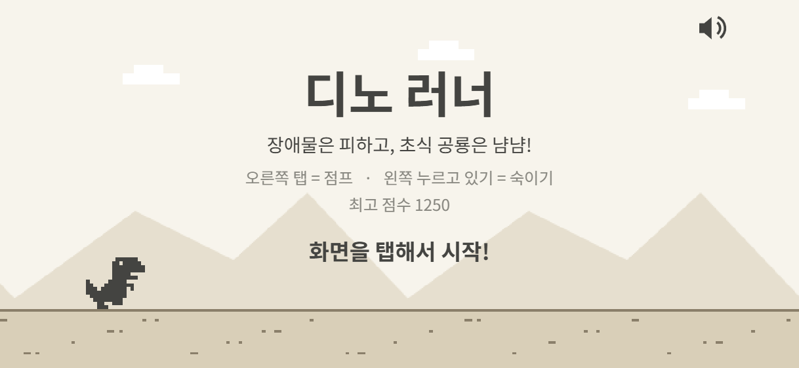
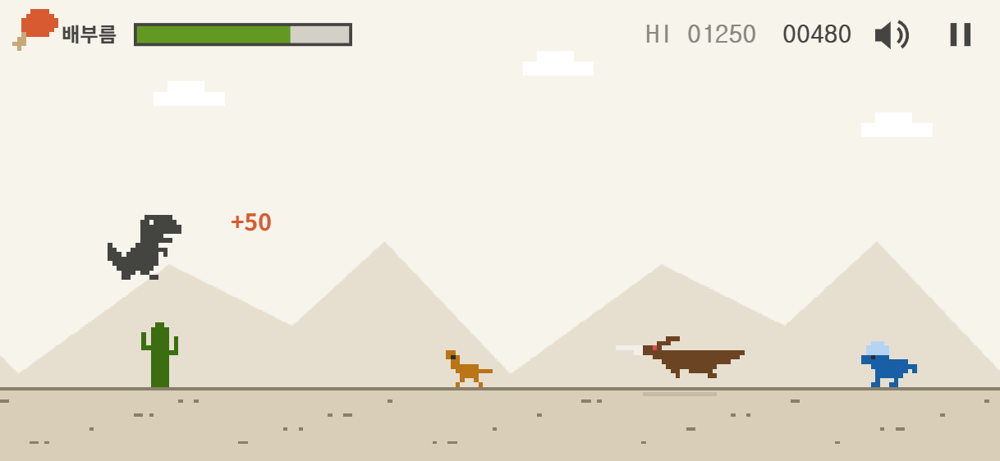
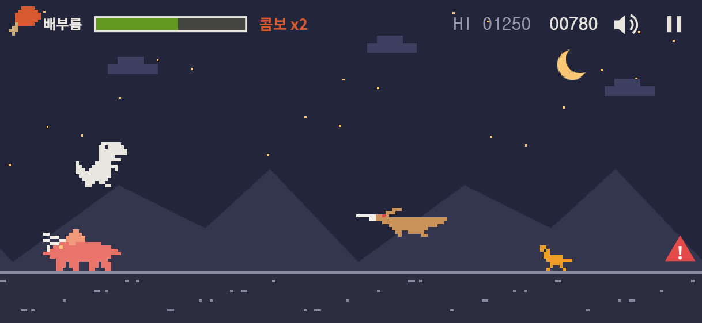
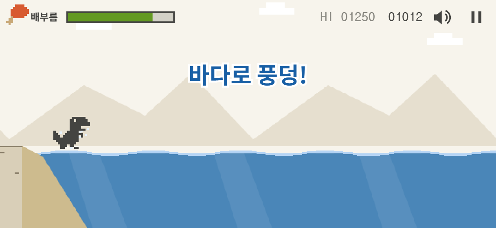
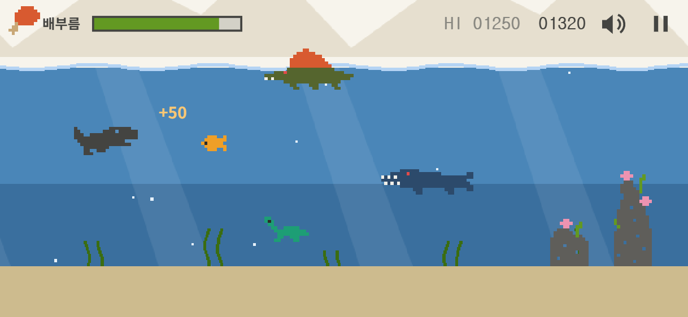

<div align="center">

# 디노 러너 (Dino Runner)

**달리고, 뛰어넘고, 냠냠!**<br>
티라노가 되어 장애물은 피하고 초식 공룡을 잡아먹는 아이용 안드로이드 게임

<br>

<a href="https://github.com/euiyoul-jeong/DinoRunner/releases/latest/download/DinoRunner.apk">
  
</a>

<br><br>


<sub>안드로이드 폰 카메라로 QR 코드를 찍으면 바로 받을 수 있어요</sub>

<br><br>



</div>

## 이런 게임이에요

- 티라노가 저절로 달려요. **화면을 탭하면 점프**, **누르고 있으면 숙여요.**
- 선인장, 바위, 무서운 공룡은 **피하고**, 작은 초식 공룡은 **닿기만 하면 냠냠** 먹어요.
- 먹을수록 **배부름**이 차요. 배부름이 바닥나면 게임이 끝나요.
- 부딪혀도 바로 끝나지 않아요. 배부름이 조금 줄고 잠깐 무적이 돼요.
- 1000점을 달리면 해변에서 **바다로 풍덩!** 헤엄치며 물속 친구들을 만나요.
- 밤과 낮이 바뀌고, 연속으로 먹으면 **콤보**로 점수가 두 배, 세 배!

## 게임 화면

<table>
  <tr>
    <td align="center"><br><sub>선인장을 뛰어넘고 작은 공룡을 냠냠</sub></td>
    <td align="center"><br><sub>밤에는 별과 달이 떠요. 빨간 <b>!</b>는 큰 공룡이 온다는 신호</sub></td>
  </tr>
  <tr>
    <td align="center"><br><sub>해변 끝에서 바다로 풍덩!</sub></td>
    <td align="center"><br><sub>물속에서는 누르고 있으면 위로 헤엄쳐요</sub></td>
  </tr>
</table>

## 등장하는 공룡들

| | 피해야 해요 | 먹어요 |
|---|---|---|
| **땅** | 선인장, 바위<br>프테라노돈 (낮게 날면 점프, 높게 날면 숙이기)<br>트리케라톱스 (점프로 넘기, 가끔 돌진해요) | 콤프소그나투스<br>파키케팔로사우루스 |
| **바다** | 암초<br>모사사우루스<br>스피노사우루스 (수면 근처에 돛을 내놓고 헤엄쳐요) | 물고기<br>작은 수룡 (아기 플레시오사우루스) |

## 조작 방법

| | 땅 | 바다 |
|---|---|---|
| 화면 **오른쪽** 탭 | 점프 (길게 누르면 더 높이) | 누르고 있으면 위로 헤엄 |
| 화면 **왼쪽** 누르고 있기 | 숙이기 | 누르고 있으면 위로 헤엄 |
| 손을 떼면 | | 천천히 가라앉아요 |
| 오른쪽 위 버튼 | 소리 끄기 · 잠깐 멈춤 | |

## 설치 방법

1. 안드로이드 폰에서 위의 **APK 다운로드** 버튼을 누르거나 QR 코드를 찍어요.
2. 받은 `DinoRunner.apk`를 열어요.
3. "출처를 알 수 없는 앱 설치"를 허용해 달라고 나오면 허용해요.
4. 홈 화면의 **디노 러너**를 눌러 시작!

테스트용(디버그) 빌드라서 Play 프로텍트 경고가 나올 수 있어요. 그래도 설치하면 돼요.

<br>

---

## 개발자용

게임 본체는 `www/`(HTML5 Canvas + 순수 JS, 빌드 도구 없음)이고, [Capacitor](https://capacitorjs.com)로 감싸 APK를 만든다.

### 브라우저에서 해보기

```bash
npm run serve
```

http://localhost:5173 을 연다. 키보드: Space/↑ 점프, ↓ 숙이기, P 멈춤, M 소리.

### APK 만들기

처음 한 번 준비:

1. **Node.js 22 이상**
2. **Android Studio** (SDK 관리용. 필요한 SDK 36은 Gradle이 알아서 받는다)
3. **JDK 21** (`winget install Microsoft.OpenJDK.21`) — Android Studio에 들어 있는 JDK 25는 이 프로젝트의 Gradle 8.14가 지원하지 않는다
4. 환경 변수: `JAVA_HOME` = JDK 21 폴더, `ANDROID_HOME` = `%LOCALAPPDATA%\Android\Sdk`
5. `npm install` 후 `npm run android:setup` (안드로이드 프로젝트 생성 + 가로 고정·전체화면 설정)

빌드:

```bash
npm run android:build
```

결과물은 `android/app/build/outputs/apk/debug/app-debug.apk`. `www/`를 고친 뒤 다시 실행하면 된다.

### 파일 구성

| 파일 | 내용 |
|---|---|
| `www/js/main.js` | 게임 루프, 상태(시작/플레이/멈춤/끝), 땅↔바다 전환, 난이도 숫자 |
| `www/js/player.js` | 티라노: 점프·숙이기·헤엄, 무적 |
| `www/js/entities.js` | 장애물·먹이 종류와 색, 이동, 충돌 상자 |
| `www/js/spawner.js` | 무엇이 언제 나올지 (등장 점수, 간격) |
| `www/js/world.js` | 배경, 밤/낮, 바다, 해변, 카메라 |
| `www/js/sprites.js` | 픽셀 그림 데이터 |
| `www/js/hud.js` | 배부름 바, 점수, 버튼, 안내 문구, 화면 글씨 |
| `www/js/audio.js` | 효과음 (파일 없이 소리 합성) |
| `www/js/native.js` | 안드로이드 연결: 진동, 뒤로가기, 상태바 |
| `scripts/android-setup.js` | 안드로이드 가로 고정·전체화면 설정 |
